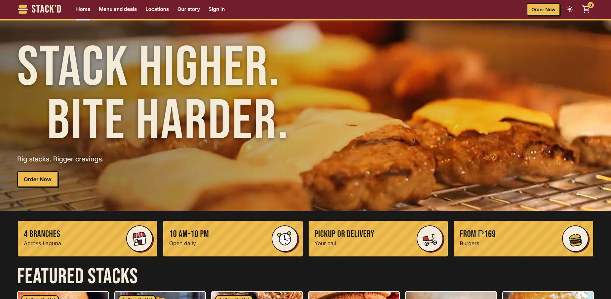
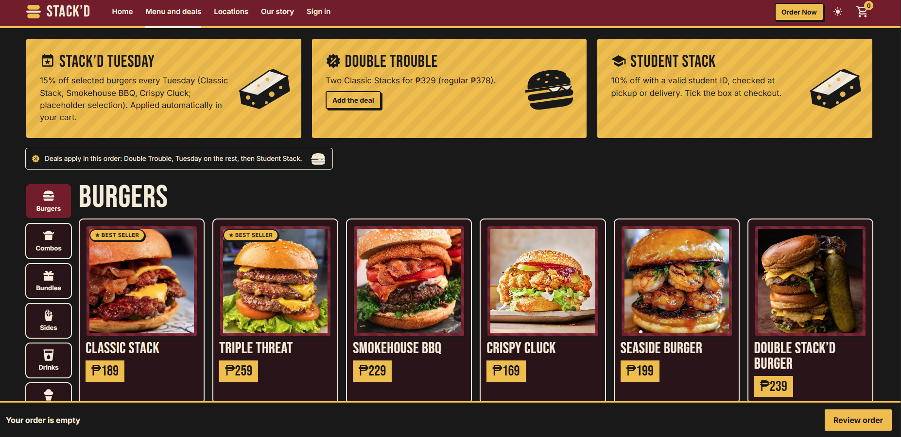
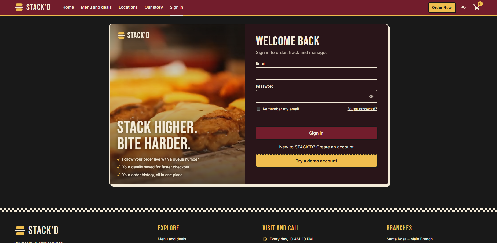
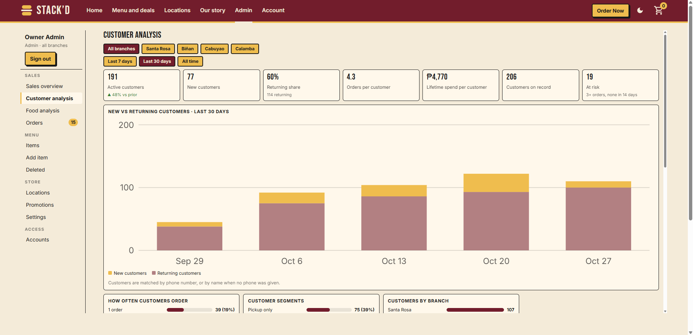

<div align="center">
  
  
  # STACK'D Burgers
  ### Next.js 14 App Router • Single-Page Application
  
  <p align="center">
    
    
    
  </p>
  
  <p align="center">
    
    
  </p>
</div>

---

## About

Next.js 14 (App Router) port of the single-file STACK'D burger restaurant site, with the app code split by functionality. This project demonstrates a progressive migration from a legacy single-file application to a modern React framework while maintaining full functionality.

## Screenshots

### Landing Page


### Menu Catalog


### Sign In


### Admin Dashboard


## Features

- **Full Restaurant Experience** - Menu browsing, cart management, checkout, and order tracking
- **Dark/Light Theme Toggle** - Persistent theme switching with localStorage
- **Responsive Design** - Mobile-first approach with fluid layouts
- **Demo Authentication** - Client-side auth with role-based access control (RBAC)
- **Admin Dashboard** - Complete management interface with 11 admin tabs
- **Video Hero Section** - Eye-catching hero video on the homepage
- **Branch Locator** - Multiple restaurant locations showcase
- **Promotions System** - Dynamic promotional offers management
- **Analytics Dashboard** - Order tracking and business insights
- **LocalStorage State** - Client-side state persistence

## Quick Start

```bash
# Install dependencies
npm install

# Development server
npm run dev

# Production build
npm run build && npm start
```

Visit [http://localhost:3000](http://localhost:3000) to see the app in action.

## Project Structure

### Next.js Components

| Path | Purpose |
|---|---|
| `app/layout.js` | Metadata, JSON-LD, fonts, theme-init script, mounts the shell and script loader |
| `app/globals.css` | All CSS styles for the application |
| `app/page.js` | Empty — the app is hash-routed (`#menu`, `#admin`, etc.) |
| `components/Shell.js` | Intro overlay + `header` / `main` / `footer` mount points |
| `components/LegacyScripts.js` | Loads `public/js/*` sequentially, once |
| `lib/scripts.js` | **Load order** of the scripts (order matters) |
| `public/hero.mp4` | Hero video asset |
| `public/icon.svg` | Application icon/logo |

### App Code (`public/js`)

These are shared-scope scripts, not ES modules, so inline `onclick="add('x')"` handlers keep working.
Later files use things declared in earlier ones; keep `lib/scripts.js` in sync when adding a file.

```
core/       util.js (PHP, Manila time, $, esc, toast) · state.js (localStorage "stackd")
data/       menu-data.js (MENU, BR, images, story)
ui/         icons.js · media.js · theme.js · modal.js · header.js · intro.js · carousel.js
features/   menu.js · branches.js · promos.js · cart.js · orders.js · contact.js · auth.js
admin/      state.js · users.js · menu-editor.js · store-settings.js · order-actions.js
            analytics.js · demo-data.js · guard.js
router.js   page registry (R), go(), route(), hashchange + link handling
pages/      home · menu (+item) · cart · checkout (+confirmation, track) · locations
            promos · about · legal · account (login, signup, account) · admin
boot.js     seed demo data/users, first render, splash
```

Each `pages/*.js` file registers its pages with `Object.assign(R, { … })`.

## Routes

The application uses hash-based routing for client-side navigation:

- `#home` - Homepage with hero video
- `#menu` - Full menu catalog
- `#cart` - Shopping cart
- `#checkout` - Order checkout flow
- `#locations` - Restaurant branches
- `#promos` - Current promotions
- `#about` - About the restaurant
- `#account` - User authentication and profile
- `#admin` - Admin dashboard (requires authentication)

## Development

### Scripts

```bash
npm run dev      # Start development server on port 3000
npm run build    # Create optimized production build
npm run start    # Start production server
npm run lint     # Run ESLint checks
```

### Tech Stack

- **Framework:** Next.js 14 with App Router
- **UI Library:** React 18
- **Styling:** CSS (globals)
- **State Management:** localStorage (legacy)
- **Routing:** Hash-based client-side routing

## Notes

- Verified in headless Chromium against the original single file: identical rendered HTML across all public pages, cart → checkout → order, demo-account login, all 11 admin tabs and the theme toggle.
- State is still `localStorage` - Auth/RBAC is a client-side demo
- Hero video now loads from `/hero.mp4` (previously inline)
- Next step toward idiomatic React: Convert one page at a time into `app/<route>/page.js` components and replace the global state with a store (Redux, Zustand, or Context API)

## Migration Path

This project represents a transitional architecture between a legacy single-file app and a modern React application:

**Current State:**
- Next.js 14 App Router structure
- Component organization
- Asset optimization

**Recommended Next Steps:**
1. Convert hash routes to Next.js file-based routing
2. Migrate from shared-scope scripts to ES modules
3. Replace localStorage with proper state management
4. Implement server-side API routes
5. Add proper authentication with sessions/JWT
6. Convert inline event handlers to React event handlers
7. Split monolithic CSS into component-scoped styles

## License

This project is private and not licensed for public use.

## Contributing

Contributions, issues, and feature requests are welcome! Feel free to check the issues page.

---

<div align="center">
  <p>Built with Next.js</p>
  
</div>
